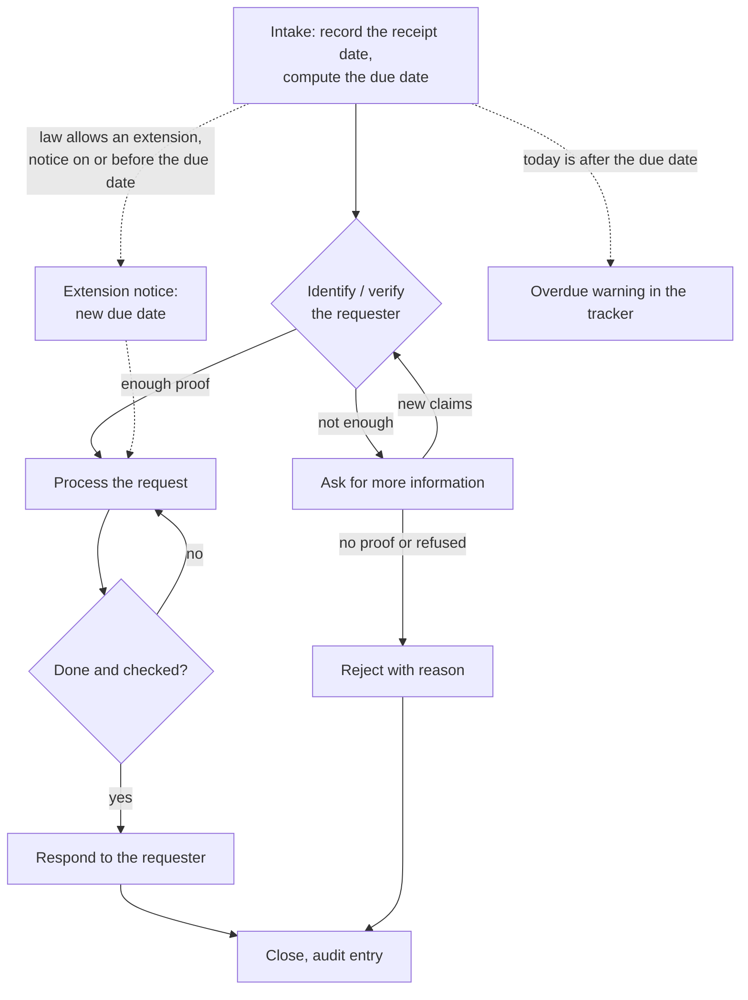

# Data-subject requests under GDPR, CCPA/CPRA and KVKK

> **This is not legal advice.**
> This page is an engineering summary of well-established, general provisions, written to explain what
> [`sdai/deadlines.py`](../sdai/deadlines.py) and [`sdai/dsr.py`](../sdai/dsr.py) model. It is simplified, it may
> be out of date, and laws, regulations and regulator guidance change. Provisions have exceptions, conditions
> and case law that are not shown here. Check the current text of each law and consult qualified counsel before
> relying on any of it for a real request.

## Terms and rights

The three regimes use different words for the same idea: a person asks an organisation what it holds about
them, or asks it to change or stop using it.

| | GDPR | CCPA as amended by CPRA | KVKK (Law No. 6698) |
|---|---|---|---|
| The person | data subject | consumer | *ilgili kişi* (data subject) |
| The organisation | controller | business | *veri sorumlusu* (data controller) |
| Applies to | processing within the Regulation's scope | businesses that meet the statutory thresholds (revenue, volume of data, or share of income from selling or sharing) | processing of personal data in Türkiye, with the Law's own exemptions (Art. 28) |

Rights as commonly summarised:

- **GDPR**: access (Art. 15), rectification (Art. 16), erasure, the "right to be forgotten" (Art. 17),
  restriction (Art. 18), portability (Art. 20), objection (Art. 21) and withdrawal of consent at any time
  (Art. 7(3)). Art. 12 sets the modalities.
- **CCPA/CPRA**: know and access (Cal. Civ. Code 1798.100, .110, .115), delete (.105), correct (.106), opt out of
  sale or sharing (.120), limit the use of sensitive personal information (.121) and non-discrimination (.125).
- **KVKK Art. 11**: learn whether data is processed, request information about it, learn its purpose, know the
  third parties it was transferred to, request correction, request erasure or destruction under Art. 7, request
  that corrections and erasures be notified to those third parties, object to a result arising exclusively from
  automated analysis, and claim compensation for damage.

## Side by side

| | GDPR | CCPA/CPRA | KVKK |
|---|---|---|---|
| Request types in this repo | access (Art. 15), erasure (Art. 17), consent withdrawal (Art. 7(3)) | know/access, delete, opt out of sale or sharing | access (Art. 11), erasure (Art. 7, 11), consent withdrawal (treated as an application, see below) |
| Who must respond | the controller | the business | the controller, to an application under Art. 13 |
| Identity verification | the controller may generally ask for additional information where it has reasonable doubts about identity (Art. 12(6)) | a *verifiable consumer request* for know, delete and correct; as commonly read, an opt-out does not need verification (CCR tit. 11 s. 7026(d)) | as commonly read, the controller may ask for information needed to confirm the applicant is the data subject, under the Application Communiqué |
| Base deadline | one month from receipt (Art. 12(3)) | 45 calendar days (1798.130(a)(2)); opt-out: no later than 15 business days (s. 7026(f)) | as soon as possible and at the latest 30 days (Art. 13(2)) |
| Extension | generally two further months where necessary, with notice and reasons within the first month | generally once, by up to 45 more days when reasonably necessary, with notice within the first 45 days | none in the Law as commonly read |
| Counting in this repo | calendar month, clamped | calendar days; opt-out Monday to Friday | calendar days |
| Fee | generally free of charge (Art. 12(5)) | generally free | generally free; a fee under the Board's tariff may apply if the action entails an extra cost |
| Refusal grounds (general) | manifestly unfounded or excessive requests may be refused or a reasonable fee charged; Art. 17(3): freedom of expression, legal obligation, public interest or public health, archiving or research, legal claims | exceptions to deletion in 1798.105(d), for example completing the transaction, security, a legal obligation, free speech, and internal uses reasonably aligned with the consumer's expectations | erasure conditions in Art. 7; retention or processing allowed under Art. 5(2), for example a legal obligation; exemptions in Art. 28 |
| Escalation | the supervisory authority of the member state, and the courts | the California Privacy Protection Agency and the Attorney General | complaint to the Personal Data Protection Board (*Kurul*, Art. 14) |

KVKK complaints to the Board are generally possible where the reply is rejected, is insufficient, or does not
come in time: within 30 days of learning the reply and in any case within 60 days of the application. Confirm
the current periods before relying on them.

## How a request flows

The generic flow is similar in all three regimes. The differences are in the clocks and in what counts as enough
proof of identity.

Mapping to [`sdai/dsr.py`](../sdai/dsr.py):

| Step | State or call |
|---|---|
| Intake | `intake()` creates the request in `received`, computes `due` |
| Identify / verify | `verify_identity()` moves to `identity_verified` or `identity_rejected` |
| Needs information | `request_info()` moves to `needs_info`; a new check follows |
| Process | `process()` moves to `processing`, then `completed` only if the post-checks pass |
| Incomplete work | stays in `processing` with an `incomplete` audit entry, visible in the tracker |
| Extension | `extend()` records the notice and the new `due`; the state does not change |
| Reject | `reject()` moves any open state to `rejected` |
| Respond | `respond()` for `completed` or `rejected`, with `on_time` against the current due date |
| Overdue warning | `tracker()` / `DSRService.queue()`: `ok`, `due_soon` (7 days or fewer left) or `overdue` |

Every transition is written to the hash-chained audit log with the subject as a keyed pseudonym
([ADR 0005](adr/0005-hash-chained-audit-log.md)).

## How this repo models the deadlines

All rules are in one table, `RULES` in [`sdai/deadlines.py`](../sdai/deadlines.py), with a citation and a note
per law and request type. The functions are pure; callers pass `today`. See
[ADR 0008](adr/0008-dsr-deadline-tracking.md) for why.

- **Day 0 is the receipt day.** A period of n days ends n days after the receipt date.
- **A month is a calendar month, with clamping.** The deadline is the same day number one month later; if that
  month is shorter, it is the last day of that month.
- **No weekend or holiday rolling, and no Regulation 1182/71.** A deadline that falls on a Saturday is returned
  as a Saturday. Public holidays are not modelled.
- **CCPA opt-out business days** are Monday to Friday with no holiday calendar. A receipt on a weekend counts
  from the next Monday.
- **An extension notice is in time on or before the original due date.**
- **KVKK has no extension** here, so `extend()` raises for it.
- **KVKK consent withdrawal** is not listed in Art. 11 as a separate right. The repo treats it as an Art. 13
  application with the same 30 days, as a conservative assumption.
- **CCPA opt-out identification.** One matching factor is enough to find the record; every other law and type
  needs two. This follows one common reading of s. 7026(d) and is not legal advice.

Worked examples, produced by calling `due_date()`:

| Receipt | Rule | Due | Note |
|---|---|---|---|
| 2028-01-31 | GDPR, one month | 2028-02-29 | clamped to the last day of a leap-year February |
| 2028-01-31 | GDPR, extended (1 + 2 months) | 2028-04-30 | clamped once, to 30 April |
| 2027-03-31 | GDPR, one month | 2027-04-30 | clamped |
| 2027-03-31 | GDPR, extended | 2027-06-30 | clamped |
| 2028-01-31 | CCPA know/delete, 45 days | 2028-03-16 | |
| 2028-01-31 | CCPA know/delete, extended (45 + 45) | 2028-04-30 | 90 days |
| 2028-01-31 | CCPA opt-out, 15 business days | 2028-02-21 | a Monday |
| 2028-01-31 | KVKK, 30 days | 2028-03-01 | |
| 2027-11-15 | GDPR / CCPA / CCPA opt-out / KVKK | 2027-12-15 / 2027-12-30 / 2027-12-06 / 2027-12-15 | |
| 2027-11-27 (a Saturday) | CCPA opt-out | 2027-12-17 | counted from Monday 29 November |

Over all 731 receipt dates of 2027 and 2028 ([`results/dsr_bench.json`](../results/dsr_bench.json)), a GDPR
one-month deadline lands 28 to 31 days after receipt (28 days on 29 receipt dates, 29 on 31, 30 on 250, 31 on
421) and the extended deadline 89 to 92 days. CCPA is always exactly 45 (or 90) days, KVKK exactly 30, and the
opt-out 19 to 21 calendar days. The sweep is shown in
[`dsr_deadlines.png`](images/dsr_deadlines.png).

## What is not covered

- Legal advice, jurisdiction analysis and whether a law applies to a given organisation (thresholds, scope,
  establishment).
- Public holidays, weekend rolling, Regulation 1182/71, and any court, regulator or national variant on how
  periods are counted.
- GDPR rights 16, 18, 20 and 21, CCPA rights 106, 121 and 125, and KVKK Art. 11 items other than access and
  erasure, as request types.
- Other CCPA/CPRA regulation timings (for example confirming receipt of a request) and state laws other than
  California.
- Legal assessment of exceptions and refusals. The repo keeps invoices under a configured legal-retention rule
  ([ADR 0006](adr/0006-kvkk-erasure.md)); whether a retention ground applies is a legal question.
- Notifying third parties of a correction or erasure (GDPR Art. 19, KVKK Art. 11), cross-border transfers,
  deceased persons, minors and representatives acting for the requester.
- Manifestly unfounded or excessive requests, fees, and identity checks beyond matching two stored factors.
- Backups, replicas and anything outside the synthetic estate ([ADR 0006](adr/0006-kvkk-erasure.md)).
